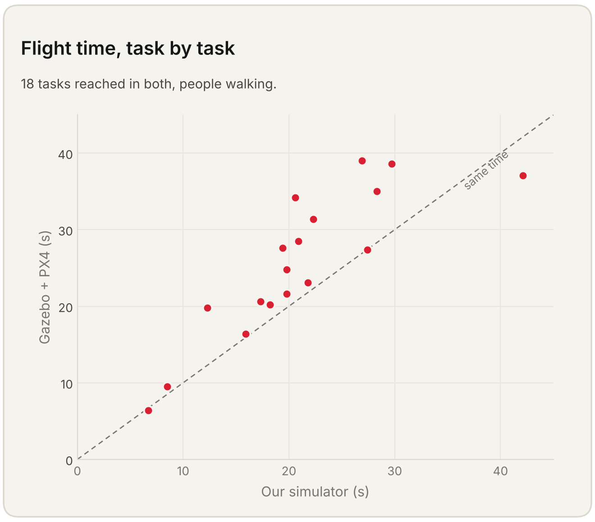

<picture>
  <source media="(prefers-color-scheme: dark)" srcset="assets/hero_dark.svg">
  
</picture>

  
  
  
  
  

  <a href="#why-we-built-it"><b>Why</b></a> ·
  <a href="#what-synex-does"><b>What it does</b></a> ·
  <a href="#how-it-was-tested"><b>Tests</b></a> ·
  <a href="#results"><b>Results</b></a> ·
  <a href="#honest-limits"><b>Limits</b></a> ·
  <a href="#what-comes-next"><b>Next</b></a> ·
  <a href="#videos"><b>Videos</b></a>

https://github.com/user-attachments/assets/7a732ff4-9cdd-47db-b555-356ea4c881fe

▶ 7-minute explainer with voice-over and subtitles: the problem, how SYNEX works, every test and every number on this page.

<table>
  <tr>
    <td align="center"><h2>98.5 %</h2>success on 1,000 fixed simulator tasks</td>
    <td align="center"><h2>0 crashes</h2>in 80 flights in Gazebo + PX4</td>
    <td align="center"><h2>13.6 M</h2>simulation steps of training (≈ 126 hours of flight)</td>
  </tr>
</table>

> [!NOTE]
> **Everything on this page is simulation.** SYNEX has not flown a real drone yet. The numbers come from our own
> greenhouse simulator and from Gazebo with PX4, the open-source flight software used on real drones. The code and
> the training method are not public; this repository shows what the system does and how it was tested.

## Why we built it

Brains are the best navigation systems we know: they learn from experience, cope with noisy senses and keep going
when the world does something unexpected. Modern AI learns in a similar way, by trial and error with rewards. We
wanted to see whether we could build **our own robot brain** that way: one that learns to fly, that we can test,
take apart and improve in every direction, and that we can drop into any simulator, from our own fast greenhouse
world to Gazebo running real flight-control software.

We picked the hardest everyday place we could think of for a small drone: **a commercial greenhouse**. Narrow aisles
between tomato rows, leaves that hang into the way, thin support wires, heating pipes, glass walls, and people
walking and pushing trolleys. GPS does not work indoors, so the drone has to rely on its own sensors.

## What SYNEX does

- **Flies from A to B** through the greenhouse, or holds a position (for inspection or a photo), on its own.
- **Sees with small, cheap sensors:** a forward depth camera with an object detector (people, wires, plants,
  hard obstacles) and a set of small time-of-flight distance sensors around the body.
- **Thinks 30 times a second:** a neural network trained with reinforcement learning decides how to fly; a separate,
  rule-based safety layer checks every command so the drone can always stop in time.
- **Remembers what it has seen** in a local map and plans a route through it.

<picture>
  <source media="(prefers-color-scheme: dark)" srcset="assets/diag_cycle_dark.svg">
  
</picture>

## How it was tested

Each step is harder and more independent than the one before:

<picture>
  <source media="(prefers-color-scheme: dark)" srcset="assets/diag_ladder_dark.svg">
  
</picture>

1. **Simulator exam:** 1,000 fixed greenhouse tasks, the same for every version of the brain, so versions can be
   compared flight by flight.
2. **Gazebo + PX4:** a different physics engine, different sensor rendering and real flight-control software. The
   brain was never trained there. Every flight is a copy of a simulator exam task (same greenhouse, start and goal).
3. **Breaking the sensors on purpose:** position drift, heading errors, sensor noise, camera mix-ups, dead sensors
   and extra latency, in both simulators.

<b>How the Gazebo flights were run</b>

 

- 20 tasks from the simulator exam, rebuilt in Gazebo with the same greenhouse, start and goal. Every flight starts
  on the floor and takes off with PX4.
- The brain gets the simulated sensor data and sends a command 30 times a second. If that rate falls below 27 per
  second, the flight does not count.
- People and trolleys walk on the same schedule as in our simulator.
- A flight fails if the drone touches anything (crash) or does not reach the goal in time (time-out).

| Error level | Position | Heading | Depth camera | Object detector | Distance sensors | Delay |
|---|---|---|---|---|---|---|
| Training-level | 15 cm, wandering | – | noise, 3 % lost pixels | misses as in training | – | – |
| Harsh | 30 cm, slow drift | 3° | 2× noise, 8 % lost | 3× misses, 10 % soft/hard mix-ups, false blobs | 5 % lost readings, a sensor dead for 1 s now and then | +67 ms |

## Results

### Every version on the same 1,000 tasks

<picture>
  <source media="(prefers-color-scheme: dark)" srcset="assets/bars_nesiller_dark.svg">
  
</picture>

Failures per 1,000 flights went from 48 to 15 in five days. Most of the remaining crashes are a person stepping in
from behind or an obstacle appearing suddenly right in front of the drone.

### An independent simulator with real flight software: 80 flights, 0 crashes

<picture>
  <source media="(prefers-color-scheme: dark)" srcset="assets/bars_gazebo_dark.svg">
  
</picture>

Brain of 9 November (before hardening), 20 tasks per round. Gazebo found real problems, all in the bridge between
the brain and the simulator, not in the brain: the depth camera saw the drone's own propellers and took them for an
obstacle 16 cm away; the drone took off facing the wrong way; and moving the simulated people slowed the brain's
loop from 30 to 4 decisions per second. Once fixed, the brain reached the goal in 18 of 20 tasks with people walking,
about 20 % slower than in our simulator:

<picture>
  <source media="(prefers-color-scheme: dark)" srcset="assets/sure_dark.png">
  
</picture>

### Bad sensors: safer after hardening

<picture>
  <source media="(prefers-color-scheme: dark)" srcset="assets/bars_dayaniklilik_dark.svg">
  
</picture>

We trained the brain further with random measurement errors in half of its flights ("hardening") and added a small
rule that moves a goal to the nearest free spot when the drone is stuck right next to it. Under harsh errors crashes
dropped from 13 to 5 per 1,000 flights; in normal conditions it is practically unchanged (16 failures per 1,000
instead of 15).

### What really slows it down: knowing where it is

<picture>
  <source media="(prefers-color-scheme: dark)" srcset="assets/bars_konum_dark.svg">
  
</picture>

Under harsh errors the drone does not crash more, it hesitates. We flew the 45 hardest flights again, changing one
error source at a time. The answer is clear: **its own position**. A tomato aisle can be 77 cm wide and the drone is
36 cm across, which leaves about 20 cm on each side. With 30–70 cm of position error the drone believes the gap is
where a plant is, sees the leaves and refuses to go down. With 15 cm of error only 10 of the 45 still time out.

> [!IMPORTANT]
> For a real greenhouse drone this sets a clear requirement for the positioning system: **about 15–20 cm in narrow
> aisles.**

## Honest limits

- Simulation only, so far. Real sensors, real air and real localization will bring new problems.
- In the simulator exam about 1 % of flights still crash, mostly a person approaching from behind or the side, or
  an obstacle that appears suddenly in front of the drone.
- With poor localization SYNEX gets slow in narrow spots. It stays safe, but it may not finish in time.

## What comes next

- [x] The brain reaches 98.5 % on the 1,000-task simulator exam
- [x] Independent test in Gazebo + PX4: 80 flights, 0 crashes
- [x] Hardening against bad sensors
- [ ] **A real drone:** run the brain on board, measure how fast it thinks, fly first in an empty hall, then in a greenhouse
- [ ] **Better around people:** react earlier to someone approaching from behind or the side
- [ ] **More than greenhouses:** warehouses, barns, factory halls, any indoor space where people and a drone share narrow paths
- [ ] **Several drones at once** sharing one map of the space

## Videos

**The explainer (7 min).** The whole story in one video: why a greenhouse, what the drone senses, one decision
cycle, the training, the test ladder and every chart on this page, plus one real Gazebo + PX4 flight replayed from
its 30 Hz log. English voice-over, subtitles burned in.

https://github.com/user-attachments/assets/7a732ff4-9cdd-47db-b555-356ea4c881fe

**The 38-second reel.** A short cartoon version for social media: a drone lost in a greenhouse, then what SYNEX
does about it.

https://github.com/user-attachments/assets/f0cef6d0-49e2-47a3-94a3-11abacde44ca

Both videos are animations, not recordings. The numbers in them are the measured results shown on this page.
New videos appear on our Instagram first.

<b>Words used on this page</b>

 

- **Crash:** the drone touched something. The flight ends.
- **Time-out:** the drone stayed safe but did not reach the goal within the time limit.
- **Gazebo:** an open-source robot simulator with its own physics and sensor rendering.
- **PX4:** open-source flight-control software used on many real drones; here it runs in the simulator.
- **dToF:** small direct time-of-flight distance sensors.
- **Hardening:** further training with random measurement errors, so the brain copes with bad sensors.

---

© 2026 SYNEX · <a href="https://github.com/MustafaBozann">@MustafaBozann</a> · All rights reserved · Questions or collaboration: open an issue on this repository.

