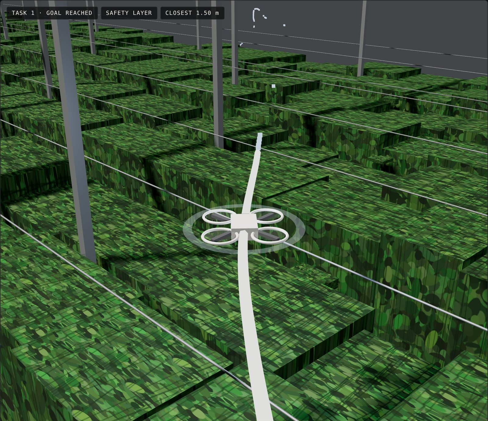
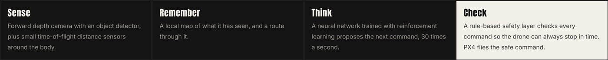
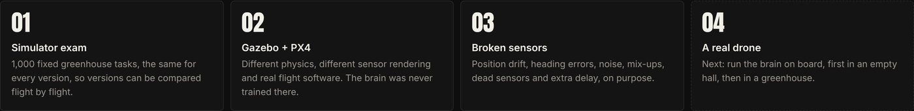
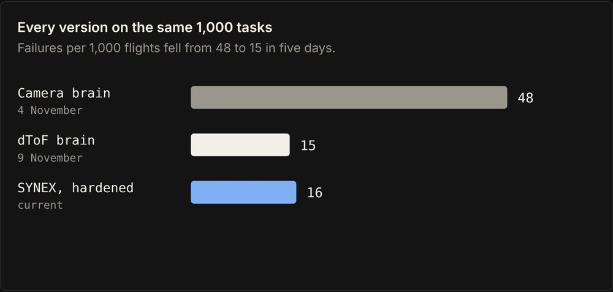
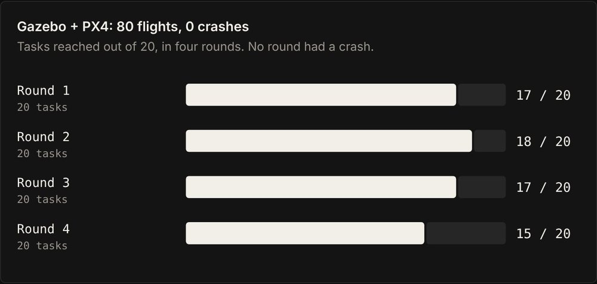
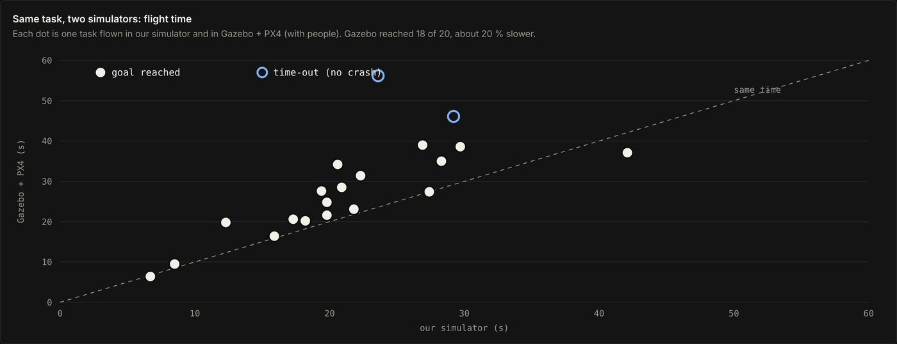
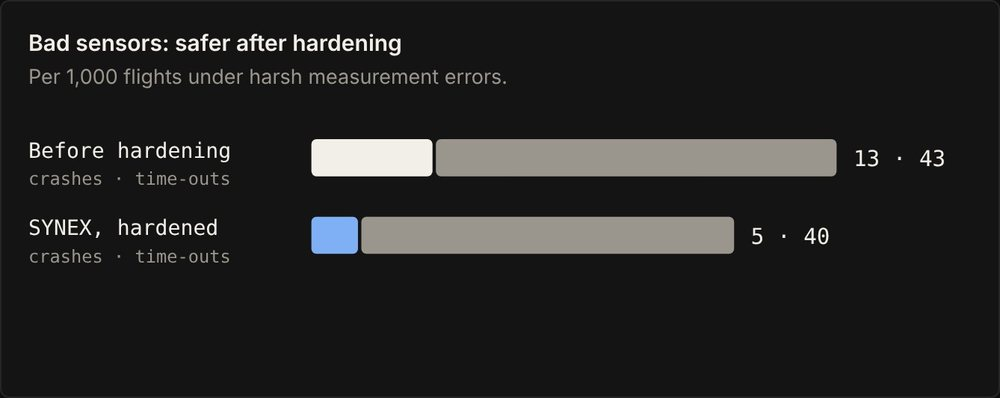
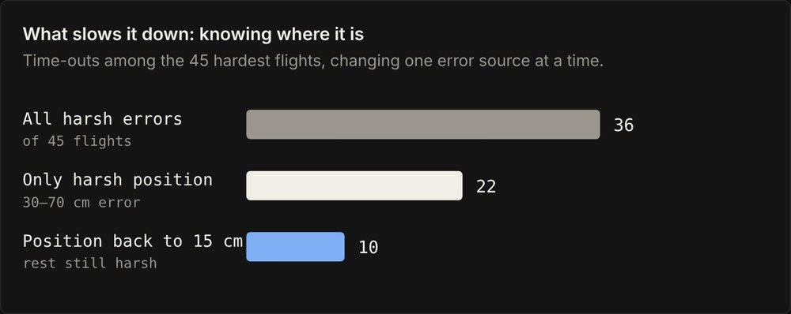

# SYNEX

**A neural brain that flies a small drone on its own, where GPS can't follow.**

Indoors there is no GPS and no room for mistakes. SYNEX is a neural network trained entirely in simulation that flies a small drone from A to B through one of the hardest everyday indoor spaces, a commercial greenhouse: narrow aisles, hanging leaves, thin wires, heating pipes, glass walls and people pushing trolleys.

**[Open the live 3D flight replay →](https://mustafabozann.github.io/Synex/)**

*A replay of a real Gazebo + PX4 flight log: the drone's logged positions, in the same simulated greenhouse with the same walking people. The white line is the flown path.*

## The numbers

| | |
|---|---|
| **98.5 %** | success on 1,000 fixed simulator tasks |
| **0 crashes** | in 80 flights in Gazebo + PX4, a simulator the brain was never trained in |
| **30 per second** | decisions, each checked by a rule-based safety layer |
| **13.6 M** | simulation steps of training (≈ 126 hours of flight) |

## How it works

Every 1/30 of a second the drone senses, remembers, thinks and checks:

| Part | What it does |
|---|---|
| **Sense** | A forward depth camera with an object detector (people, wires, plants, hard obstacles) and small time-of-flight distance sensors around the body. |
| **Remember** | A local map of what it has seen, and a route through it. |
| **Think** | A neural network trained with reinforcement learning proposes the next command. |
| **Check** | A rule-based safety layer checks every command so the drone can always stop in time. PX4, the open-source flight software used on real drones, flies the safe command. |

## How it was tested

Each step is harder and more independent than the one before. The Gazebo flights are copies of simulator exam tasks (same greenhouse, start and goal), with people and trolleys walking on the same schedule. A flight fails if the drone touches anything (crash) or does not reach the goal in time (time-out).

## Results

**Every version on the same 1,000 tasks.** Failures per 1,000 flights fell from 48 to 15 in five days. Most remaining crashes are a person stepping in from behind or an obstacle appearing suddenly right in front.

**An independent simulator with real flight software: 80 flights, 0 crashes.** Gazebo found real problems, all in the bridge between the brain and the simulator, not in the brain: the camera saw the drone's own propellers as an obstacle, the drone took off facing the wrong way, and moving the simulated people slowed the brain from 30 to 4 decisions per second. Once fixed, it reached the goal in 18 of 20 tasks with people walking.

**Same task, two simulators.** Flight time per task. Gazebo + PX4 is about 20 % slower; the two time-outs had no crash.

**Bad sensors: safer after hardening.** Further training with random measurement errors in half of the flights. Under harsh errors, crashes dropped from 13 to 5 per 1,000 flights; in normal conditions the result is practically unchanged (16 failures per 1,000 instead of 15).

**What really slows it down: knowing where it is.** We flew the 45 hardest flights again, changing one error source at a time. A tomato aisle can be 77 cm wide and the drone is 36 cm across. With 30–70 cm of position error the drone believes the gap is where a plant is and refuses to go down; with 15 cm only 10 of the 45 still time out.

> [!IMPORTANT]
> For a real greenhouse drone this sets a clear requirement for the positioning system: **about 15–20 cm in narrow aisles.**

## Honest status

- **Everything on this page is simulation.** SYNEX has not flown a real drone yet. Real sensors, real air and real localization will bring new problems.
- In the simulator exam about 1 % of flights still crash, mostly a person approaching from behind or the side.
- With poor localization the drone gets slow in narrow spots. It stays safe, but may not finish in time.
- The code and the training method are not public. This repository shows what the system does and how it was tested.

## What comes next

- [x] 98.5 % on the 1,000-task simulator exam
- [x] Independent test in Gazebo + PX4: 80 flights, 0 crashes
- [x] Hardening against bad sensors
- [ ] **A real drone:** run the brain on board, first in an empty hall, then in a greenhouse
- [ ] **Better around people:** react earlier to someone approaching from behind or the side
- [ ] **More than greenhouses:** warehouses, barns, factory halls

## Contact

Interested in testing SYNEX on your drone or in your space? Open an [issue in this repository](../../issues/new) or write to **synex636@gmail.com**.

© 2026 SYNEX · All rights reserved.
